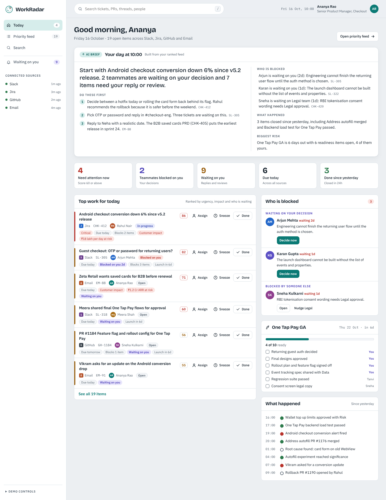

# WorkRadar

**One ranked view of everything that needs a product manager today.**

Product managers start every day by stitching together Slack, Jira, GitHub and Email to answer four questions:

1. What is my top work today?
2. What happened since yesterday?
3. What needs my attention right now?
4. Who is blocked, and is it on me?

WorkRadar answers all four on one screen. It pulls every signal into a single feed, scores each item with transparent rules (every point shows up as a reason chip), and writes a daily brief with Claude. PMs can decide, assign, snooze, nudge or close work without leaving the page.



## Features

| Area | What it does |
| --- | --- |
| **Today dashboard** | AI brief, five clickable stat tiles, top work, who is blocked (split into *waiting on your decision* and *blocked elsewhere*), launch readiness, and a timeline of what happened |
| **AI brief** | Built instantly from the ranked feed. **Write with Claude** rewrites it as structured JSON. Every line links to its source item, and invented ids are dropped |
| **Priority feed** | Thirteen filters with live counts (focus, source, state), sorted by a 0 to 99 score with reason chips |
| **Item details** | Summary, blocker callout, one click **decision picker** that unblocks the teammate, suggested next step, **Ask Claude** for a plan and a ready to send draft, source thread, related work, activity log |
| **Actions** | Assign (with each teammate's open load), Mark done, Snooze (Later today, Monday morning, Day before launch), Nudge external blockers, Reopen, and **Undo** on every change |
| **Search** | One search across all sources: keywords, `@person`, `source:jira`, `is:blocked`, `is:mine`, `is:done`, `is:snoozed`, plus **Ask Claude** for plain language questions |
| **States** | Empty radar, no results, filter with no items, GitHub sync failure with reconnect, AI unavailable fallback |
| **Quality** | Keyboard first (`/` to search, `Esc` closes dialogs, focus trap, skip link), WCAG AA contrast, light theme, responsive to 390 px, reduced motion support |

## Quick start

```bash
git clone https://github.com/<you>/workradar.git
cd workradar
npm install
npm run dev
```

Open http://localhost:5173. The app runs fully on realistic mock data and its local summary engine. No keys are needed.

### Turn on Claude

```bash
cp .env.example .env        # add your ANTHROPIC_API_KEY
npm run dev:api             # terminal 1: API server on :8787
npm run dev                 # terminal 2: app on :5173 (proxies /api)
```

Or run everything on one port: `npm start` (builds, then serves the app and API on http://localhost:8787).

When the app runs inside a Claude artifact it uses the viewer's Claude account instead, with no server needed.

## Scripts

| Command | Purpose |
| --- | --- |
| `npm run dev` | Vite dev server |
| `npm run dev:api` | Zero dependency Node API server (`/api/health`, `/api/ai`) |
| `npm test` | Unit tests for ranking, search, brief, actions and JSON parsing (Vitest) |
| `npm run typecheck` | Strict TypeScript check |
| `npm run build` | Production build to `dist/` (app plus `styleguide.html`) |
| `npm run build:single` | One self contained HTML file in `dist-single/` for hosting anywhere |
| `npm start` | Build and serve app plus API |
| `npm run figma:export` | Export every screen as editable Figma SVG frames to `docs/figma/` (needs `npx vite preview --port 4173` running) |

## Project structure

```
src/
  App.tsx                 routing, toasts, AI provider, app context
  types.ts                WorkItem, Person, Launch, Brief
  data/mockData.ts        demo clock, team, 22 work items, launch, timeline
  lib/ranking.ts          transparent priority score with reasons
  lib/selectors.ts        derived views: attention, blocked on you, launch progress
  lib/summary.ts          local brief engine (no AI needed)
  lib/search.ts           query parser and search
  lib/prompts.ts          Claude prompts and tolerant JSON parsing
  lib/ai.ts               AI providers: Claude artifact runtime or /api/ai
  state/store.ts          reducer, undo, local persistence
  components/             Shell, Brief, ItemRow, Dialogs, EmptyState, ui atoms
  pages/                  Dashboard, Feed, Detail, Search
  styleguide.tsx          design system and cover frames for Figma
server/index.mjs          API and static server
scripts/figma/            DOM to SVG exporter for the Figma file
docs/                     PRD, AI workflow, demo script, Figma frames
```

## How ranking works

```
score = severity (critical 40, high 26, medium 14, low 5)
      + due today 20 | tomorrow 11 | within 3 days 4
      + blocked on you 16 | blocked elsewhere 10
      + 5 for each item it blocks
      + customer impact 10 + revenue at risk 6
      + waiting on you 9 + part of a launch within 7 days 5
      + open more than 2 days 5
capped at 99. Score 60 or more = needs attention now.
```

Weights live in `src/lib/ranking.ts`. The AI never reorders items. It summarises the ranked list, so a PM can always audit why something is on top.

## Roadmap

* Read only OAuth connectors for Slack, Jira, GitHub, Gmail and Outlook with webhooks
* Write back: assign in Jira, request review in GitHub, send nudges in Slack
* Thumbs up or down on ranking to tune weights per PM
* 9:00 brief delivered to Slack, weekly stakeholder update drafts
* Multi product view for group PMs and directors

## Docs

* [Product Requirements Document](docs/WorkRadar_PRD.pdf)
* [AI Workflow](docs/WorkRadar_AI_Workflow.pdf)
* [Demo video script](docs/WorkRadar_Demo_Script.pdf)
* [Figma design file and import guide](docs/figma/README.md)

## License

MIT
